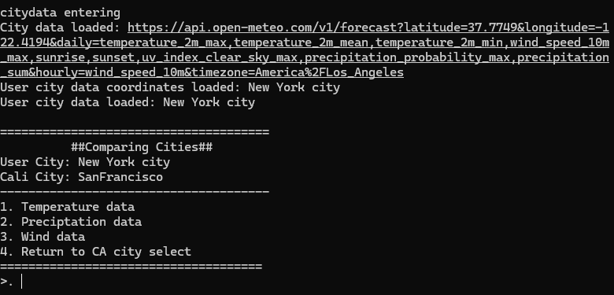

# Californian City Comparison
https://open-meteo.com/en/docs
https://geocode.maps.co/docs/endpoints/

A terminal app that compares the users city weather data with five big californian cities.

* Unit switching (temperature, precipitation measurement, wind speed)
* Current windspeed, max windspeed
* Days forecast based on average heat

The terminal app is small and uses Geocode api to translate the users city into a coordinate that the Openmateo API uses to find the weather of the chosen locations
